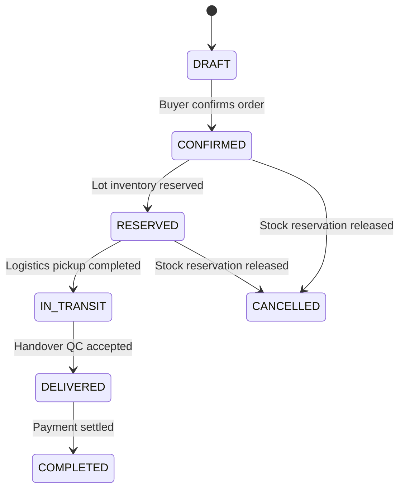
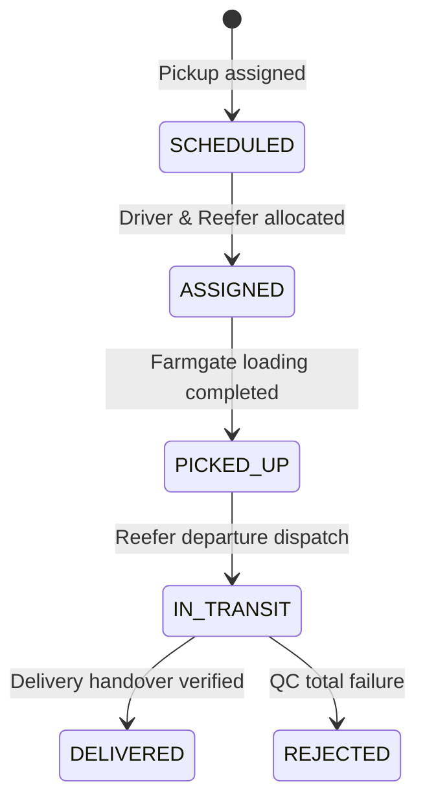
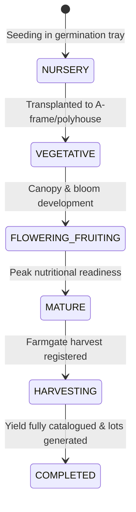

# Project Backbone — Domain Model & Relational Schema

## 1. Domain Overview & Invariant Architecture

Project Backbone's relational data model enforces rigorous agricultural and financial traceability. Every harvest lot can be audited upstream to its nursery planting and IoT microclimate conditions, and downstream to cold-chain delivery and instant UPI settlement.

---

## 2. Core Business Invariants

The database schema and service layer strictly enforce the following invariants:

### Invariant 1: Anti-Oversell Stock Protection & Concurrency
- `availableQuantityKg` represents unreserved physical stock.
- Active purchase orders decrement `availableQuantityKg` and increment `reservedQuantityKg` atomically inside a database transaction (`prisma.$transaction`).
- If requested `quantityKg > availableQuantityKg`, the service immediately aborts with an `INVARIANT_VIOLATION` exception.
- When competing buyers submit concurrent orders for the same stock, transactional isolation guarantees that exactly one succeeds and the other fails safely without partial or negative allocation.
- When an order is cancelled or adjusted, the held reservation is released back to the available pool.
- Validated by automated tests: [`tests/inventory-invariants.test.ts`](file:///d:/farmers/tests/inventory-invariants.test.ts) and [`tests/business-invariants-comprehensive.test.ts`](file:///d:/farmers/tests/business-invariants-comprehensive.test.ts).

### Invariant 2: Pure Settlement Calculation & Deductions Audit
- Farmer settlement amounts are never estimated or altered by floating-point drift.
- **Formula:**
  $$\text{Net Payable} = (\text{Accepted Quantity (kg)} \times \text{Agreed Unit Price (INR/kg)}) - \text{Explicit Deductions}$$
- Deductions (e.g. returnable crate deposit or bio-seed advance) must be explicitly itemized with a documented reason.
- Validated by automated test: [`tests/finance-invariants.test.ts`](file:///d:/farmers/tests/finance-invariants.test.ts).

### Invariant 3: 24-Hour Settlement SLA & Settlement Record Linkage
- Every farmgate accepted harvest lot generates a `FarmerPayable` with `dueDate` set strictly within 24 hours ($T + 24\text{h}$).
- A payable cannot be transitioned to `SETTLED` status without an atomically linked `Settlement` record capturing the transaction reference (`UPI-TXN-...`), timestamp, and operator attribution.
- In prototype simulation, disbursements occur within an average of 2.5 hours via instant UPI rails.

### Invariant 4: Mandatory Audit Reasons for Inventory Adjustments
- Manual adjustments to harvest lot quantities require an explicit documented reason of at least 5 characters.
- Every adjustment generates an immutable `AuditLog` entry storing the actor ID, timestamp, before/after states, and rationale.

### Invariant 5: Delivery Requires Prior Dispatch
- A shipment cannot be updated to `DELIVERED` status without having first transitioned through `IN_TRANSIT`.
- Quality inspection records accepted vs rejected quantities at handover; only accepted produce enters farmer payable calculations.

### Invariant 6: Truth in Telemetry & Source Attribution
- Every sensor reading, generated advisory, payout reference, and quality check records its origin in a `source` field (`SIMULATED`, `DEMO`, `TEST`, or `VERIFIED_LIVE`).
- This guarantees full transparency and prevents simulated prototype data from being misrepresented as live telemetry.

---

## 3. Entity State Machines

### 3.1 Order Lifecycle

### 3.2 Shipment Lifecycle

### 3.3 Crop Cycle Lifecycle

---

## 4. Entity Dictionary

### `User`
- Represents a system actor belonging to one of the 6 roles: `FARMER`, `FRANCHISE_OPERATOR`, `AGRONOMIST`, `BUYER`, `LOGISTICS_OPERATOR`, `ADMIN`.
- Linked to specific sub-profiles (`FarmerProfile`, `BuyerProfile`).

### `FarmUnit`
- Physical plot unit (fixed pilot size: 0.25 acres).
- Located in Warangal or Mulugu district with GPS coordinates and assigned infrastructure tier.

### `InfrastructureInstallation`
- Hardware assets installed at the farm:
  - *Tier 1:* Vertical Hydroponic A-Frames (PVC channels, solar pump, automated Dosatron).
  - *Tier 2:* Semi-Closed Poly-Canopies (200-micron UV sheet, 40-mesh insect net, micro-foggers).
  - *Tier 3:* Farmgate Processing & Grain Silos (5-MT hermetic silo, solar convective dehydrator).

### `CropCatalogue` & `CropCycle`
- `CropCatalogue` defines configurable baseline parameters (duration days, daily water requirements in liters, target yield per acre, benchmark market price).
- `CropCycle` tracks an active planting on a specific farm unit through the 6 life stages.

### `SensorDevice`, `SensorReading`, `SensorAlert`
- IoT hardware monitoring soil moisture (%), electrical conductivity (mS/cm), pH level, ambient temperature (°C), relative humidity (%), solar radiation (W/m²), and irrigation flow rate (LPM).
- Generates threshold alerts when parameters breach agronomic safety bands.

### `HarvestRecord` & `HarvestLot`
- `HarvestRecord` captures gross farmgate harvested yield, harvest date, and quality notes.
- `HarvestLot` partitions the harvest into graded, traceable batches (e.g. `GRADE_A` at ₹40/kg, `GRADE_B` at ₹32/kg).
- Manages stock invariants: `initialQuantityKg = availableQuantityKg + reservedQuantityKg + soldQuantityKg + spoiledQuantityKg`.

### `BuybackOffer` & `BuybackResponse`
- Configurable minimum off-take agreements offering guaranteed baseline pricing plus Grade-A quality bonuses.
- `commitFarmerBuyback` establishes farmer off-take agreements, preventing duplicate commitments.

### `Order` & `OrderLine`
- B2B procurement contract created by institutional buyers.
- Each `OrderLine` establishes an active inventory reservation against a specific `HarvestLot`.

### `Shipment` & `QualityInspection`
- `Shipment` tracks cold-chain transit via refrigerated mini-van (TS-03-EB-4192) with temperature logging (4.0°C target).
- `QualityInspection` records acceptance inspection at delivery destination (accepted kg, rejected kg, freshness score out of 10).

### `FarmerPayable` & `Settlement`
- `FarmerPayable` establishes the financial liability calculated strictly from accepted produce.
- `Settlement` stores the disbursed transaction reference (`UPI-TXN-TELANGANA-...`), method, and clearance duration (< 24h SLA).

### `AuditLog`
- Immutable system ledger recording actor identity, action type, entity references, previous state, new state, and rationale.
